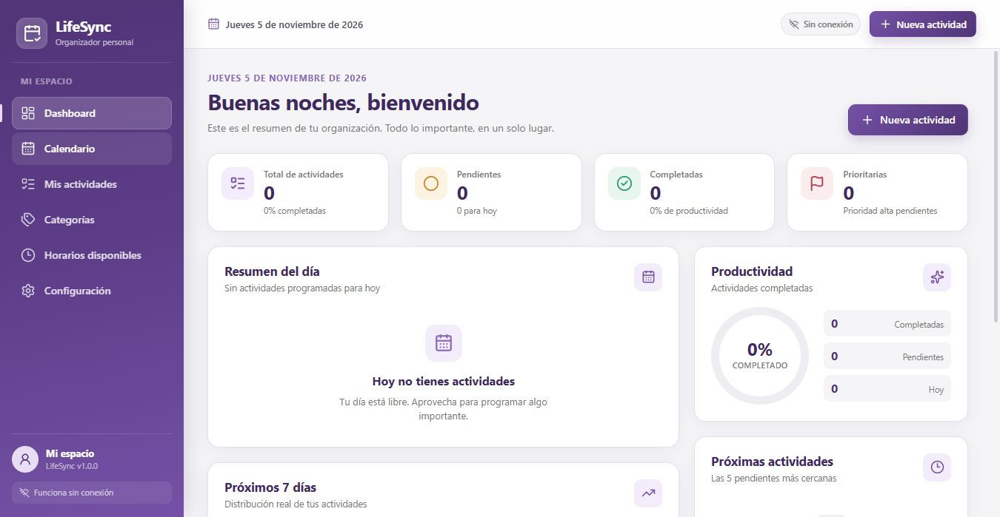
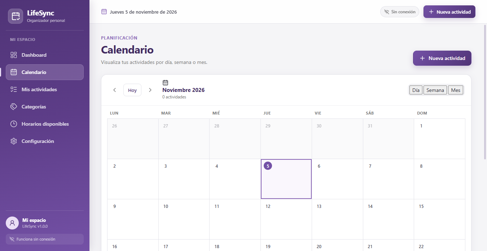

# LifeSync

LifeSync es una aplicación de escritorio **offline** para organizar actividades, horarios y disponibilidad personal. Está construida con **Electron, React, TypeScript y SQLite**, con una interfaz completa en español y un diseño moderno en tonos morados.



## Contenido

- [Características](#características)
- [Instalación en Windows](#instalación-en-windows)
- [Uso rápido](#uso-rápido)
- [Dónde se guardan los datos](#dónde-se-guardan-los-datos)
- [Copias de seguridad](#copias-de-seguridad)
- [Desarrollo](#desarrollo)
- [Pruebas](#pruebas)
- [Compilación del instalador](#compilación-del-instalador)
- [Estructura del proyecto](#estructura-del-proyecto)
- [Seguridad](#seguridad)
- [Notas y limitaciones](#notas-y-limitaciones)

## Características

### Dashboard
- Saludo personalizado según la hora y el nombre configurado.
- Tarjetas con total de actividades, pendientes, completadas, prioridad alta y conflictos.
- Tasa de finalización y actividades de hoy.
- Próximas actividades y gráfico de los próximos 7 días.
- Distribución por categorías.

### Calendario
- Vista **día**, **semana** y **mes**.
- Navegación anterior/siguiente y botón para volver a hoy.
- Actividades coloreadas por categoría, con hora, prioridad y estado.
- Detección visual de solapamientos.
- Creación de actividades desde una fecha concreta.

### Mis actividades
- CRUD completo: crear, consultar, editar y eliminar.
- Búsqueda por título o descripción.
- Filtros por categoría, prioridad, estado y rango de fechas.
- Orden ascendente o descendente.
- Cambio rápido de estado pendiente/completada.
- Agrupación por fecha y vista de detalle.
- Validación de campos y cálculo automático de la duración.

### Conflictos de horario
- Comprobación **antes de guardar** desde la interfaz y también en el proceso principal.
- Diálogo con las actividades que se superponen.
- Opción de volver y ajustar el horario o **guardar de todas formas**.
- Los solapamientos se resaltan en las vistas de actividades y calendario.

### Categorías
- Categorías iniciales: Personal, Académica, Laboral, Salud y Otros.
- Creación y edición con nombre y color.
- Paleta de colores predefinida y selector de color.
- Validación de nombres duplicados sin distinguir mayúsculas, minúsculas ni acentos.
- Eliminación con reasignación de actividades a otra categoría.
- La categoría **Otros** está protegida y no puede eliminarse.

### Horarios disponibles
- Cálculo de huecos libres a partir de la jornada configurada.
- Descuento de actividades y fusión de intervalos solapados.
- Indicadores de tiempo ocupado, tiempo libre y porcentaje de ocupación.
- Vista diaria y resumen de los próximos días.

### Configuración
- Nombre del usuario.
- Inicio y fin de la jornada.
- Duración predeterminada de nuevas actividades.
- Primer día de la semana.
- Ruta de la base de datos y apertura de la carpeta de datos.
- Exportación e importación de copias de seguridad en JSON.
- Información de la última copia automática.
- Versiones de la aplicación, Electron, Node y Chrome.
- Protección frente a cambios sin guardar.



## Instalación en Windows

### Opción recomendada: instalador

1. Abre la carpeta `release`.
2. Ejecuta `LifeSync-1.0.0-Setup.exe`.
3. Elige la carpeta de instalación y confirma.
4. El instalador crea accesos directos en el escritorio y en el menú Inicio.

La aplicación instalada funciona sin conexión y no necesita Node.js ni ninguna otra dependencia.

> El instalador no está firmado digitalmente. Windows SmartScreen puede mostrar un aviso la primera vez; usa **Más información → Ejecutar de todas formas** si confías en el archivo.

### Opción de desarrollo

Requiere **Node.js 22 o superior** (probado con Node 26) y npm.

```powershell
npm install
npm run dev
```

## Uso rápido

1. Abre **Configuración** y escribe tu nombre, jornada y duración preferida.
2. Crea actividades desde **Mis actividades**, el **Calendario** o el botón de nueva actividad.
3. Si una actividad se superpone con otra, LifeSync mostrará el conflicto antes de guardar.
4. Consulta **Horarios disponibles** para encontrar huecos libres.
5. Revisa el **Dashboard** para ver el estado general de tu planificación.

Atajos del formulario de actividad:

- `Ctrl + Enter`: guardar.
- `Esc`: cerrar el diálogo.

## Dónde se guardan los datos

La base de datos SQLite se guarda en:

```text
%APPDATA%\LifeSync\lifesync.db
```

Las copias automáticas se guardan en:

```text
%APPDATA%\LifeSync\backups
```

La ruta exacta se puede consultar y abrir desde **Configuración → Datos y respaldo**.

### Copias automáticas

- Se crea una copia al iniciar la aplicación si ya existe una base de datos.
- Se conservan las **10 copias más recientes**.
- Antes de importar un respaldo se crea una copia adicional con el prefijo `lifesync-preimport-`.

## Copias de seguridad

### Exportar

**Configuración → Exportar copia de seguridad** genera un archivo JSON con categorías, actividades y configuración.

### Importar

**Configuración → Importar copia de seguridad** valida el archivo y pide confirmación antes de reemplazar los datos actuales. Si el archivo no es válido, no se modifica nada.

La importación:

- Valida el formato y las fechas/horas con Zod.
- Recalcula las duraciones.
- Reasigna actividades huérfanas a la categoría **Otros**.
- Restaura la configuración incluida en el respaldo.

## Desarrollo

```powershell
# Instalar dependencias
npm install

# Ejecutar en modo desarrollo con recarga
npm run dev

# Comprobar TypeScript
npm run typecheck

# Ejecutar pruebas
npm test

# Compilar la aplicación
npm run build

# Generar el instalador NSIS
npm run dist
```

### Notas para el entorno de desarrollo

- Si `better-sqlite3` no encuentra su binario, ejecuta `npm install --ignore-scripts` y después `node node_modules/electron/install.js`; el paquete incluye binarios N-API precompilados para Windows x64.
- El proyecto no necesita Python ni Visual Studio Build Tools para ejecutarse con el binario precompilado.

## Pruebas

La suite usa **Vitest** y cubre la lógica pura y la persistencia real con SQLite en memoria:

- Utilidades de fecha y hora.
- Detección de solapamientos y conflictos.
- Cálculo de disponibilidad, fusión de intervalos y ocupación.
- Esquemas de validación con Zod.
- Inicialización y migraciones de la base de datos.
- CRUD, filtros, ordenación y estados de actividades.
- CRUD de categorías, duplicados y reasignación.
- Configuración y valores por defecto.
- Servicios de disponibilidad y métricas del dashboard.

Resultado actual:

```text
Test Files  5 passed (5)
Tests       56 passed (56)
```

```powershell
npm test
```

## Compilación del instalador

```powershell
npm run dist
```

El artefacto se genera en:

```text
release\LifeSync-1.0.0-Setup.exe
```

También se puede generar una carpeta sin instalador con:

```powershell
npm run dist:dir
```

## Estructura del proyecto

```text
LifeSync/
├─ shared/                     Tipos, constantes, esquemas y lógica de dominio
│  ├─ domain/
│  │  ├─ time.ts               Conversión y validación de fechas/horas
│  │  ├─ conflicts.ts           Detección de solapamientos
│  │  └─ availability.ts        Cálculo de huecos libres
│  ├─ constants.ts
│  ├─ schemas.ts
│  └─ types.ts
├─ src/
│  ├─ main/                    Proceso principal de Electron
│  │  ├─ database/             Conexión, esquema, migraciones y seed
│  │  ├─ ipc/                  Handlers IPC validados con Zod
│  │  ├─ repositories/         Acceso a SQLite
│  │  ├─ services/             Reglas de negocio y copias de seguridad
│  │  ├─ index.ts              Ciclo de vida de la aplicación
│  │  └─ window.ts             Ventana segura
│  ├─ preload/                 Puente IPC mediante contextBridge
│  └─ renderer/                Interfaz React
│     ├─ src/components/
│     ├─ src/context/
│     ├─ src/hooks/
│     ├─ src/pages/
│     ├─ src/services/
│     ├─ src/styles/
│     └─ src/utils/
├─ tests/                      Pruebas Vitest
├─ build/                      Iconos de la aplicación
├─ docs/                       Capturas de pantalla
├─ electron.vite.config.ts
├─ vitest.config.ts
└─ package.json
```

## Seguridad

La aplicación sigue el modelo de seguridad recomendado por Electron:

- `contextIsolation: true`.
- `nodeIntegration: false`.
- `sandbox: true`.
- `webSecurity: true`.
- Preload mínimo que solo expone una API tipada mediante `contextBridge`.
- Validación de todos los datos que llegan por IPC con Zod.
- Apertura de ventanas externas bloqueada.
- Navegación restringida al origen local de la aplicación.
- Webviews bloqueadas.
- Permisos de sesión denegados por defecto.
- Content Security Policy en el HTML.
- Sin peticiones de red: todos los datos son locales.
- Errores del proceso principal registrados en `%APPDATA%\LifeSync\logs\main.log`.

## Notas y limitaciones

- Los datos son locales a cada equipo y usuario de Windows.
- No hay sincronización en la nube ni cuentas de usuario.
- Las actividades no pueden cruzar la medianoche: la hora de fin debe ser posterior a la de inicio.
- La categoría **Otros** no se puede eliminar.
- La aplicación está pensada para Windows 10 y Windows 11.
- La interfaz está en español.
- Las capturas incluidas se generaron durante la verificación automatizada de la aplicación.

---

**LifeSync 1.0.0** · Organizador personal de horarios y actividades.
